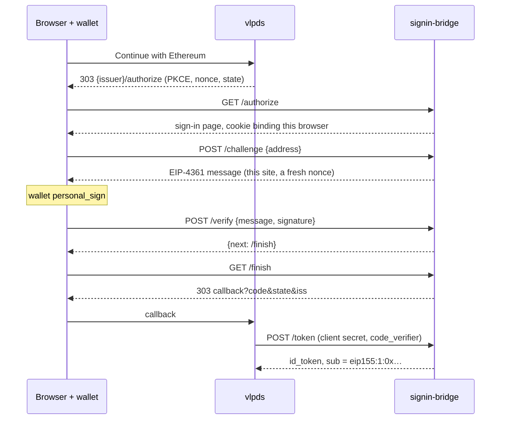

# signin-bridge

An OpenID Connect provider for sign-in methods vlpds doesn't speak. vlpds has no wallet code. It
adds this service as one more sign-in provider and only ever sees an issuer and a subject
(`docs/operations/sign-in-providers.md`, "Methods that aren't OpenID Connect"). Sign-In with Ethereum
(EIP-4361) is the one method so far.



## Running it

It's one container behind your reverse proxy, on a path of the PDS's own host. The proxy forwards
the prefix as it is, without stripping it, and `SIGNIN_BRIDGE_PUBLIC_URL` names that prefix. With
Caddy, for example:

```caddy
pds.example.com {
    handle /signin-bridge/* {
        reverse_proxy signin-bridge:8080
    }
    reverse_proxy vlpds:2583
}
```

Use the PDS's host. The wallet shows the user the host it's signing in to (the message's domain is
the public URL's host), so a separate domain is one more name for people to check.

Run one replica. Sign-ins in flight live in its memory for at most 10 minutes, so a restart only
makes those few start again. A second replica behind the same route would see half of them fail.

| Variable | What it is |
|---|---|
| `SIGNIN_BRIDGE_PUBLIC_URL` | The URL the proxy sends here, `https://pds.example.com/signin-bridge`. The SIWE issuer is `{public_url}/siwe` |
| `SIGNIN_BRIDGE_SIGNING_KEY_FILE` | A PKCS#8 PEM P-256 key that signs id_tokens. Make one with `signin-bridge generate-key` |
| `SIGNIN_BRIDGE_RETIRED_KEY_FILES` | Earlier keys, comma-separated. They stay in the key set and never sign |
| `SIGNIN_BRIDGE_CLIENT_ID`, `SIGNIN_BRIDGE_CLIENT_SECRET` | What vlpds authenticates with. The secret needs at least 32 characters |
| `SIGNIN_BRIDGE_REDIRECT_URIS` | vlpds's callback for the provider, `{vlpds public_url}/oauth/federated/callback/{id}`. Exact match, comma-separated |
| `SIGNIN_BRIDGE_SIWE_STATEMENT` | The line wallets show above the details. Default "Sign in with your Ethereum account." |
| `SIGNIN_BRIDGE_SIWE_CHAINS` | Chain IDs a message may name. Default `1`, and the page always asks for the first |
| `SIGNIN_BRIDGE_ETH_RPC` | `CHAIN=URL` pairs, comma-separated, for contract wallets (below) |
| `SIGNIN_BRIDGE_LISTEN` | Default `0.0.0.0:8080` |

`GET /healthz` answers on the listener for the container's health check. The proxy doesn't route it.

## The provider in vlpds

Add it from the console, the CLI or `vlpds.admin.putSignInProvider`:

```json
{
  "id": "ethereum", "name": "Ethereum",
  "issuer": "https://pds.example.com/signin-bridge/siwe",
  "clientId": "vlpds",
  "clientAuth": { "method": "client_secret_basic", "secret": { "value": "<SIGNIN_BRIDGE_CLIENT_SECRET>" } },
  "scopes": ["openid", "profile"], "idTokenAlgs": ["ES256"],
  "signup": "off", "trustEmail": false
}
```

The bridge sends no email. With `signup` on, vlpds asks the user for one and confirms it by mail.
The `profile` scope adds `preferred_username`, the checksummed address, which vlpds shows next to
the linked identity.

## Identities

The subject is `eip155:{chain}:{address}`, address lowercase (`eip155:1:0x2c75…5c23`). It never
changes for the same wallet, and vlpds keys the identity on it plus the issuer. That means two
things to keep fixed once people have linked wallets:

- The issuer URL. A new host or path is a new issuer, and every linked wallet is stranded.
- The chain list. The chain is in the subject, so the same key signing for chain 8453 is a different
  identity than on chain 1. The page always asks for the first chain. A frontend that builds its own
  message can name any listed chain, and gets that chain's subject.

vlpds links one identity per issuer to an account. Each method here gets its own issuer for that
reason, so a later method (a QR sign-in from the app, say) doesn't take SIWE's slot.

## What's checked

The message has to parse as EIP-4361 and name this site's host, the issuer as its URI, version 1, a
listed chain and the nonce of this sign-in. Its Issued At has to fall inside the sign-in's 10
minutes (60 s of skew). The address has to be in EIP-55 checksum form, which every SIWE library
produces. A wallet gets five tries per sign-in.

A plain-key wallet's signature is checked by recovering its key. Anything else is a contract wallet
(Safe, Coinbase Smart Wallet, other smart accounts), checked on its chain with one `eth_call` that
runs the ERC-6492 validator without deploying it, as viem's `verifyHash` does. That covers deployed
ERC-1271 wallets and undeployed ones whose signature carries their factory call. It needs
`SIGNIN_BRIDGE_ETH_RPC` for the chain. Without it, contract wallets are refused with a message
saying so. At most 16 of these calls run at once.

Each sign-in is bound to the browser that started it by an `HttpOnly` cookie. Only that browser can
ask for the message, submit the signature or collect the code, and it collects the code once. The
token endpoint wants the client secret, the PKCE verifier and the exact redirect URI, and a code
works once within 60 s.

## The page

The page is plain HTML with one script and no build step. It lists the wallets the browser
announces through EIP-6963 (MetaMask, Rabby, Coinbase Wallet's extension and others), falls back to
`window.ethereum`, and works inside a wallet app's own browser. WalletConnect (scanning a QR code
with a phone wallet) isn't on it, since that needs the WalletConnect SDK bundled and a Reown project
ID. The endpoints already take what it produces, including smart wallet signatures, so adding it is
a frontend change.

## Adding a method

A method is a `Method` variant (`src/lib.rs`) with its own routes. Everything else is shared.
`/authorize` makes a pending request bound to the browser, the method completes it with a subject
(`oidc::complete`), and the browser then goes to `/finish` for the code. A method that completes
from another device only needs its completion route and a way for the waiting browser to learn the
request is done.

## Development

```bash
cargo test                      # unit tests and tests/flow.rs, which plays vlpds over HTTP
cargo run -- generate-key > key.pem
SIGNIN_BRIDGE_CLIENT_SECRET=$(openssl rand -hex 24) cargo run -- serve \
  --public-url http://127.0.0.1:8080/signin-bridge --signing-key-file key.pem \
  --client-id vlpds --redirect-uri http://127.0.0.1:2583/oauth/federated/callback/ethereum
```

Plain `http` is accepted for a loopback public URL only.
